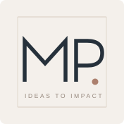

<picture>
  <source media="(prefers-color-scheme: dark)" srcset="./assets/monogram-dark.svg" />
  <source media="(prefers-color-scheme: light)" srcset="./assets/monogram-light.svg" />
  
</picture>

MEHNAAZ PARVEEN M  /  DATA SCIENCE & SOFTWARE

# Hi, I'm Mehnaaz.

I like the space where **ideas become useful software**.

I'm a Computer Science & Engineering (Data Science) undergraduate at BITM, Ballari (class of 2028). I enjoy making sense of a problem before writing the solution—whether that means exploring data, training a model, or designing an interface that someone can actually use.

[**Portfolio**](https://mehnaaz-portfolio.vercel.app/) &nbsp;·&nbsp; [LinkedIn](https://www.linkedin.com/in/mehnaaz-parveen-m-426072335/) &nbsp;·&nbsp; [Email](mailto:mehnaazparveen800@gmail.com)

 

---

## Things I've built

**[ScrapWise](https://github.com/Safa-Mahin7/ScrapWise)** &nbsp; FLUTTER · DART · APPLICATION DESIGN  
A scrap management platform connecting households, collectors, and traders. I worked on the Flutter Android/web experience, authentication, multilingual screens, and role-based interfaces. Scrap forecasting and e-waste analysis are part of the wider team project.

**[Hybrid PCOS Analysis](https://github.com/Mehnaazparveen/Hybrid-PCOS-Analysis)** &nbsp; PYTHON · TENSORFLOW · EXPLAINABLE AI  
A research prototype with separate symptom-based assessment and ultrasound PCOM-visibility workflows, built using Logistic Regression, MobileNetV2, and Grad-CAM. For educational research, not medical diagnosis.

**[Smart Bank Loan Prediction](https://github.com/Mehnaazparveen/smart-bank-loan-prediction-system)** &nbsp; REACT · FLASK · MACHINE LEARNING  
A full-stack app for exploring preliminary loan eligibility, EMI estimates, and credit-related insights. It's a learning tool, not an official lending decision system.

**[Smart Campus Lost & Found Matcher](https://github.com/Mehnaazparveen/WORKSHOP)** &nbsp; FLASK · NLP · SQLITE  
A campus tool for reporting missing items and finding potential matches, using TF-IDF and cosine similarity even when item descriptions differ.

---

## The tools I reach for

`Python` `SQL` `Dart` `JavaScript` `Flutter` `React` `Flask` `Streamlit`  
`Scikit-learn` `TensorFlow` `Pandas` `NumPy` `OpenCV` `Git` `GitHub`

I especially enjoy **machine learning, practical data exploration, and thoughtful application design**.

## Beyond the code

**Secretary — IEEE Computer Society, BITM (2025–2026)**  
Contributed to organizing and coordinating Codathon through the chapter.

**Research and Literature Club, BITM**  
Active member.

---

Still curious. Still learning. Always looking for a better way to build.
